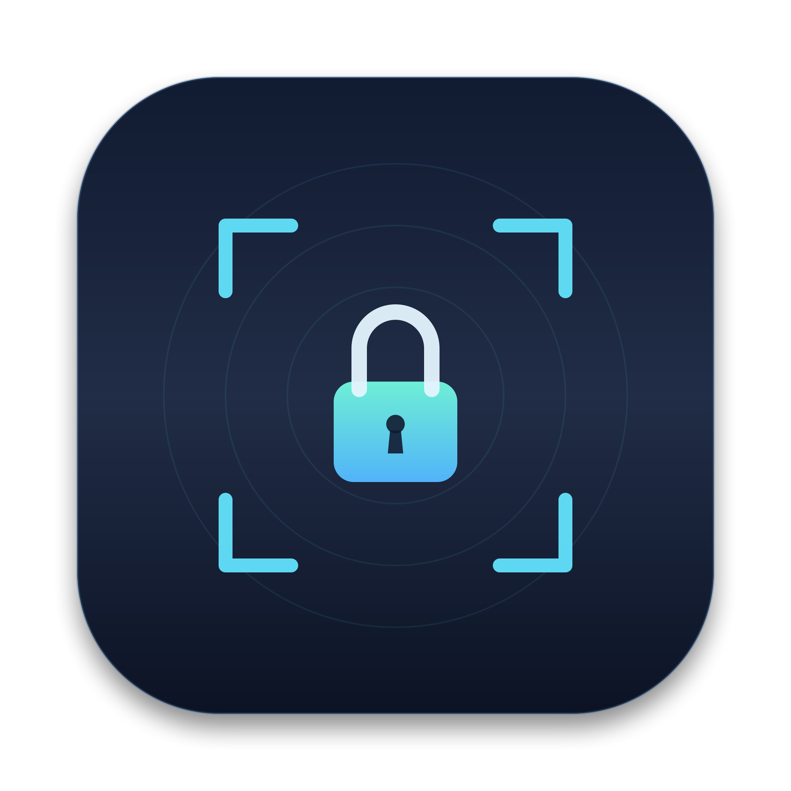
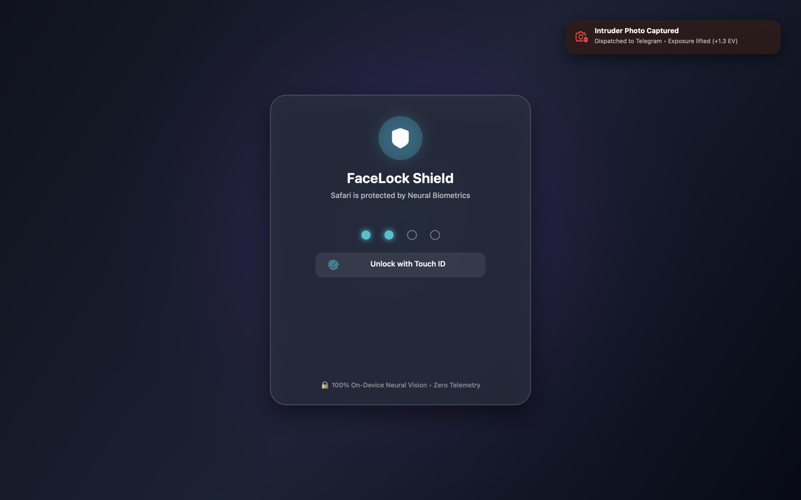
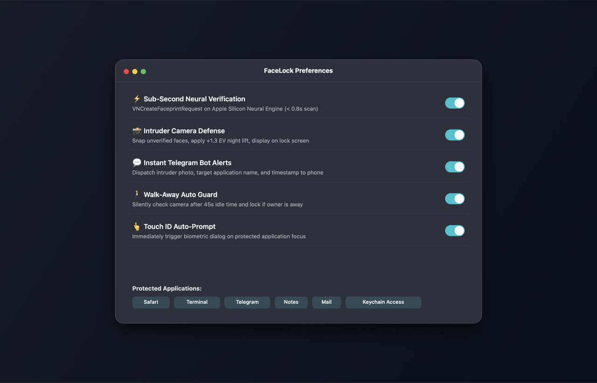

<p align="center">
  
</p>

<h1 align="center">FaceLock</h1>

<p align="center">
  <strong>Native biometric application shield and intruder defense system for macOS.</strong><br>
  Instant neural camera verification on app-switch, intruder capture with night HDR lift, Telegram alerts, and anti-spoofing walk-away lock.
</p>

<p align="center">
  <a href="https://github.com/MaxSphinx/FaceLock/releases"></a>
  <a href="https://github.com/MaxSphinx/FaceLock/actions"></a>
  
  
  
  
  
</p>

<p align="center">
  
  
</p>

---

## Overview

**FaceLock** transforms your Mac’s built-in FaceTime HD / TrueDepth camera into an active biometric barrier. Whenever an unauthorized person touches your Mac or attempts to switch windows, FaceLock intercepts the action within milliseconds, snapshots the intruder, sends an instant alert to your Telegram, and enforces a fullscreen lock that cannot be bypassed via standard shortcuts.

Built strictly in modern **Swift & native AppKit**, with **zero external package dependencies** and **zero cloud telemetry**. Everything runs 100% on-device on the Apple Neural Engine.

---

## Architecture Flow

```text
 ┌────────────────┐
 │  Window Switch │ (NSWorkspace.didActivateApplicationNotification)
 └───────┬────────┘
         │
         ▼
 ┌────────────────┐      ┌─────────────────────────────┐
 │ Low-Light Cam  ├─────►│ Apple Neural Engine         │
 │ (AVFoundation) │      │ (Vision ANFRv4 128-D Vector)│
 └────────────────┘      └──────────────┬──────────────┘
                                        │
                                        ▼
                         ┌─────────────────────────────┐
                         │ Dual-Verification Evaluator │
                         │ d_min ≤ 0.22 & top3 ≤ 0.27  │
                         └──────┬───────────────┬──────┘
                                │               │
                    [MATCH]     │               │     [MISMATCH / TIMEOUT]
         ┌──────────────────────┘               └──────────────────────┐
         ▼                                                             ▼
┌──────────────────┐                                          ┌──────────────────┐
│ HUD Confirmation │                                          │ Intruder Defense │
│ Seamless Pass    │                                          │  • Night HDR Pic │
└──────────────────┘                                          │  • Telegram Alert│
                                                              │  • Shield Lock   │
                                                              └──────────────────┘
```

---

## Key Features

- **⚡️ Sub-Second Neural Verification**: Computes 128-dimensional biometric embeddings on the Apple Neural Engine (`VNCreateFaceprintRequest`). Matches owner facial contours with strict cosine distance thresholds ($d \le 0.22$).
- **🛡️ Unbypassable Fullscreen Shield**: Renders a dark glassmorphic barrier at `.screenSaver` window level (`CGWindowLevelForKey(.screenSaverWindow)`). Intercepts <kbd>Esc</kbd>, <kbd>Cmd+Q</kbd>, <kbd>Cmd+W</kbd>, <kbd>Cmd+M</kbd>, and system overlays.
- **📸 Intruder Snapshot & Night-Mode Lift**: Automatically crops intruder faces with 80% shoulder headroom. Applies low-light exposure boosting (+1.3 EV) and tone curve equalization so faces remain crystal clear in dark rooms.
- **📱 Instant Telegram Bot Alerts**: Dispatches the intruder’s high-resolution photograph, exact timestamp, and targeted application directly to your private Telegram chat via official Bot API.
- **🎯 Universal & Selective Vault Modes**:
  - **All Applications**: Continuous biometric verification across every window focus.
  - **Selective Mode**: Guards only confidential apps (Telegram, Safari, Chrome, Terminal, Notes, Photos, WhatsApp, etc.).
- **🚶‍♂️ Walk-Away Auto Lock**: Monitors user idle state (`CGEventSource`). If keyboard/mouse are inactive for 45s, FaceLock silently verifies presence via camera. If you stepped away, the Mac locks immediately.
- **👁️ Liveness Verification**: Analyzes facial landmark contours (`VNDetectFaceLandmarksRequest`) to thwart 2D screen or paper printout attacks.
- **🎛️ Native Menu Bar & CLI**: One-click protection toggle, calibration wizard, incident log gallery, and full terminal CLI tooling.

---

## Why FaceLock? (Comparison)

| Capability | Standard macOS Lock | Commercial Lock Apps | **FaceLock** |
|:---|:---:|:---:|:---:|
| **Per-App Focus Verification** | ❌ No | ❌ No | **✅ Instant Neural Check** |
| **Intruder Capture with Night HDR** | ❌ No | ⚠️ Basic webcam | **✅ Exposure Lift (+1.3 EV) & Crop** |
| **Instant Telegram Incident Alerts** | ❌ No | ❌ No | **✅ Photo + Timestamp + App** |
| **Unbypassable Shield (`.screenSaver`)**| ❌ No | ⚠️ Standard window | **✅ Blocks Cmd+Q, Cmd+W, Esc** |
| **Walk-Away Inactivity Defense** | ⚠️ Inactivity timer | ⚠️ Flaky Bluetooth | **✅ CGEvent + Silent Neural Camera** |
| **Neural Engine Acceleration** | ❌ | ❌ | **✅ 100% Apple Silicon ANE** |
| **Privacy & Local Storage** | ✅ Yes | ❌ Cloud telemetry | **✅ 100% On-Device & Zero Telemetry** |
| **License & Price** | Closed source | \$15 – \$35 | **✅ Free & Open Source (MIT)** |

---

## Installation

### Option 1: Homebrew Cask (Recommended)

Install directly via the official Homebrew tap:

```bash
brew install --cask MaxSphinx/facelock/facelock
```

### Option 2: Quick One-Liner

Open Terminal and paste:

```bash
/bin/bash -c "$(curl -fsSL https://raw.githubusercontent.com/MaxSphinx/FaceLock/main/scripts/install.sh)"
```

### Option 3: Pre-built Binary Download

Download the signed archive directly from [**GitHub Releases**](https://github.com/MaxSphinx/FaceLock/releases):
1. Download [`FaceLock-macOS-arm64.zip`](https://github.com/MaxSphinx/FaceLock/releases/latest).
2. Extract and drag `FaceLock.app` into `/Applications/`.

### Option 4: Build from Source

```bash
git clone https://github.com/MaxSphinx/FaceLock.git
cd FaceLock
make install
```

---

## Quick Start

### 1. Initial Calibration (30 seconds)
Train FaceLock with your face under multiple angles:

```bash
facelock --enroll
```
*Look at the camera and slowly tilt your head up, down, left, and right. FaceLock records 12 diverse neural vectors.*

### 2. Configure Telegram Alerts (Optional)
Receive intruder photos on your phone:
1. Message [@BotFather](https://t.me/BotFather) on Telegram and send `/newbot` to create your alert bot.
2. Get your numeric User ID from [@userinfobot](https://t.me/userinfobot).
3. Open settings:
```bash
facelock --settings
```
4. Enter your **Bot Token** and **Chat ID**, then click **«Тест бота»** to confirm.

### 3. Verify Daemon Status
```bash
facelock --status
```

---

## CLI Reference

FaceLock comes with a first-class command-line interface:

| Command | Description |
|:---|:---|
| `facelock --enroll` | Launch interactive camera calibration wizard |
| `facelock --settings` | Open configuration GUI (Telegram, PIN, App lists) |
| `facelock --gallery` | Open captured intruder incident gallery |
| `facelock --lock` | Trigger immediate fullscreen security shield |
| `facelock --toggle` | Toggle protection between ACTIVE and PAUSED |
| `facelock --pause [mins]` | Pause protection for N minutes (default: 15) |
| `facelock --resume` | Resume protection immediately |
| `facelock --config [--json]` | Display active FaceLock configuration settings |
| `facelock --apps [--json]` | List protected and ignored application bundle IDs |
| `facelock --protect-app <id>` | Add application bundle ID to protected list |
| `facelock --unprotect-app <id>` | Remove application bundle ID from protected list |
| `facelock --set-pin <pin>` | Set lock screen unlock PIN from terminal |
| `facelock --set-telegram <tok> <id>` | Configure Telegram bot credentials and enable alerts |
| `facelock --enable-telegram` | Enable Telegram intruder photo alerts |
| `facelock --disable-telegram` | Disable Telegram intruder alerts |
| `facelock --set-walkaway <sec\|off>` | Configure walk-away timeout (10-600s) or disable ('off') |
| `facelock --set-threshold <val>` | Set similarity threshold (0.05 - 0.60, default: 0.22) |
| `facelock --set-timeout <sec>` | Set camera verification timeout (0.5 - 10.0s, default: 2.0s) |
| `facelock --set-debounce <sec>` | Set app switch debounce interval (0.5 - 30.0s, default: 2.0s) |
| `facelock --set-mode <mode>` | Set mode: 'all' (every app) or 'selective' (secret apps) |
| `facelock --diagnostics` | Run full biometric, hardware & storage diagnostics |
| `facelock --test-lock` | Trigger fullscreen security shield test |
| `facelock --status` | Display daemon status and biometric template metrics |
| `facelock --incidents [--json]` | List logged intruder incident captures and disk usage |
| `facelock --latest-incident [--json]` | Inspect details of the most recent intruder capture |
| `facelock --clear-incidents` | Purge all saved intruder photo captures from disk |
| `facelock --prune-incidents <n>` | Prune intruder captures keeping latest N photos |
| `facelock --verify-face [--timeout]` | Instant one-shot facial biometric check without locking |
| `facelock --verify-pin <pin>` | Verify candidate PIN against active lock screen PIN |
| `facelock --test-telegram` | Dispatch verification alert to configured Telegram chat |
| `facelock --reset` | Purge all enrolled facial vectors |
| `facelock --version` | Output version and platform architecture |
| `facelock --help` | Show comprehensive CLI guide |

---

## Run as Background Service (LaunchAgent)

To have FaceLock start automatically upon login:

```bash
cat << 'EOF' > ~/Library/LaunchAgents/io.github.facelock.plist
<?xml version="1.0" encoding="UTF-8"?>
<!DOCTYPE plist PUBLIC "-//Apple//DTD PLIST 1.0//EN" "http://www.apple.com/DTDs/PropertyList-1.0.dtd">
<plist version="1.0">
<dict>
    <key>Label</key>
    <string>io.github.facelock</string>
    <key>ProgramArguments</key>
    <array>
        <string>/Applications/FaceLock.app/Contents/MacOS/FaceLock</string>
    </array>
    <key>RunAtLoad</key>
    <true/>
    <key>KeepAlive</key>
    <true/>
</dict>
</plist>
EOF

launchctl load ~/Library/LaunchAgents/io.github.facelock.plist
```

To stop and unload:
```bash
launchctl unload ~/Library/LaunchAgents/io.github.facelock.plist
```

---

## Security & Privacy Model

- **No Cloud Dependencies**: FaceLock operates completely offline (except optional Telegram alert dispatches initiated directly by your own bot token to Telegram's HTTPS endpoint).
- **No Third-Party Analytics**: Zero tracking, zero telemetry, zero analytics libraries.
- **Biometric Storage**: Facial representations are stored strictly as 128-float mathematical embeddings in `~/.facelock/owner_face_vectors.json`. Original training camera frames are discarded immediately after vector extraction.
- **Hardware Acceleration**: All image tensor transformations leverage the Apple Neural Engine (ANE) via Apple's Vision framework, ensuring minimal CPU usage and negligible battery impact.

---

## Configuration File

Settings are stored at `~/.facelock/config.json`:

```json
{
  "isEnabled": true,
  "protectionMode": "all",
  "similarityThreshold": 0.22,
  "verificationTimeout": 2.0,
  "debounceSeconds": 2.0,
  "walkAwayLockEnabled": true,
  "walkAwayIdleSeconds": 45.0,
  "livenessDetectionEnabled": true,
  "telegramEnabled": false,
  "telegramBotToken": "",
  "telegramChatId": "",
  "pin": "0000",
  "autoTriggerTouchID": true,
  "showHUD": true
}
```

---

## Документация на русском языке

<details>
<summary><b>Нажмите, чтобы развернуть описание на русском</b></summary>

### Основные возможности
1. **Биометрия Apple Vision (ANFRv4)**: Сравнение 128-мерных векторов лица на Apple Neural Engine с порогом $d \le 0.22$. Исключает ложные срабатывания на посторонних.
2. **Экран блокировки уровня `.screenSaver`**: Перекрывает систему, блокирует горячие клавиши (<kbd>Cmd+Q</kbd>, <kbd>Cmd+W</kbd>, <kbd>Esc</kbd>) и разблокируется только по Touch ID или PIN.
3. **Ночной режим фотосъемки**: Автоматическое осветление теней и подъем экспозиции (+1.3 EV) при съемке нарушителя в темной комнате.
4. **Мгновенные алерты в Telegram**: Отправка фото нарушителя, имени приложения и точного времени прямо в ваш Telegram-чат.
5. **Авто-замок при уходе**: Если за Mac никого нет 45 секунд, FaceLock проверяет камеру и блокирует экран при отсутствии пользователя.

### Установка в одну команду
```bash
git clone https://github.com/MaxSphinx/FaceLock.git
cd FaceLock
make install
```
</details>

---

## Contributing

Contributions, bug reports, and feature requests are welcome!
Feel free to open an issue or submit a pull request.

1. Fork the Project
2. Create your Feature Branch (`git checkout -b feature/AmazingFeature`)
3. Commit your Changes (`git commit -m 'Add some AmazingFeature'`)
4. Push to the Branch (`git push origin feature/AmazingFeature`)
5. Open a Pull Request

---

## ⭐️ Star History & Support

If FaceLock protects your MacBook or you find it useful, please consider giving it a **Star** on GitHub — it directly supports future development and features!

<p align="center">
  <a href="https://star-history.com/#MaxSphinx/FaceLock&Date">
    
  </a>
</p>

---

## License

Distributed under the **MIT License**. See [`LICENSE`](LICENSE) for more information.
